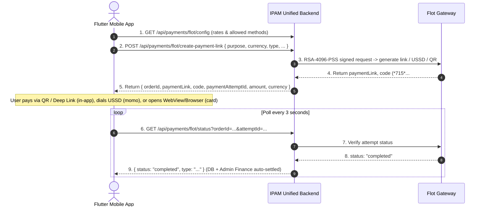

# 13. Payments (Flot Payment Gateway — SLE & USD) API Integration

* **Swagger UI Documentation:** [https://ipam.billnbite.cloud/api-docs#/Payments](https://ipam.billnbite.cloud/api-docs#/Payments)
* **Tag:** `Payments`
* **Security Schemes:** `BearerAuth`

---

## 📌 Overview

The Payments module uses the **Flot Payment Gateway** across all financial transactions in IPAM:
1. **Physical ID Card Orders** (`purpose: "physical_card"`)
2. **Paid Event Ticket Bookings** (`purpose: "event_registration"`)
3. **Membership Subscriptions** (`purpose: "subscription"`)
4. **University Giving / Donations** (`purpose: "donation"`)

### Dual-Currency & Payment Method Rules
* **SLE (Sierra Leone Leones / NLe):** Supports **Flot App (`in-app`)**, **Mobile Money (`momo` — `*715*...#` USSD)**, and **Bank Card (`card`)**.
* **USD (US Dollars):** Supports **Bank Card (`card`) ONLY**. (`1 USD ≈ 22.50 SLE`, dynamically configured via `/api/payments/flot/config`).

---

## 🔄 Mobile Checkout Flow Architecture



---

## 🛣️ Endpoints Breakdown

### 1. Get Flot Gateway Config & Dual-Currency Rates
* **Method & Path:** `GET /api/payments/flot/config`
* **Auth Required:** `None`

#### Success Response (`200 OK`)
```json
{
  "data": {
    "gateway": "FLOT",
    "currencies": ["SLE", "USD"],
    "defaultCurrency": "SLE",
    "usdToSleRate": 22.5,
    "methodsByCurrency": {
      "SLE": [
        { "id": "in-app", "label": "Flot App", "description": "Open Flot app or scan QR code" },
        { "id": "momo", "label": "Mobile Money", "description": "Dial *715*...# USSD code" },
        { "id": "card", "label": "Bank Card", "description": "Visa / Mastercard via Flot secure page" }
      ],
      "USD": [
        { "id": "card", "label": "Bank Card", "description": "USD payments accept Bank Card only" }
      ]
    },
    "pollingIntervalMs": 3000,
    "cardPricing": { ... },
    "subscriptionTiers": { ... }
  }
}
```

---

### 2. Create Flot Payment Link
* **Method & Path:** `POST /api/payments/flot/create-payment-link`
* **Auth Required:** `BearerAuth` (Optional for `donation`)

#### Supported Payloads
* **Paid Event Booking:** `{ "purpose": "event_registration", "eventId": "evt_1", "ticketCount": 2, "attendeePhone": "+23276...", "currency": "SLE", "type": "momo" }`
* **Physical Card Order:** `{ "purpose": "physical_card", "cardTier": "GOLD_RFID_SMART", "currency": "SLE", "type": "in-app", "recipientName": "...", "recipientPhone": "...", "deliveryAddress": "...", "createPendingOrder": true }`
* **Subscription Upgrade:** `{ "purpose": "subscription", "subscriptionTier": "GOLD_PATRON", "billingCycle": "ANNUAL", "currency": "USD", "type": "card" }`
* **Giving / Donation:** `{ "purpose": "donation", "fund": "Undergraduate & Merit Scholarship Endowment", "amount": 100, "currency": "SLE", "type": "in-app", "donorName": "...", "donorEmail": "...", "donorPhone": "..." }`

#### Success Response (`200 OK`)
```json
{
  "data": {
    "orderId": "BK-EVT-MWX8-A1B2",
    "amount": 100,
    "currency": "SLE",
    "paymentType": "momo",
    "paymentLink": "https://app.flotme.ai/...",
    "code": "*715*4908906923#",
    "paymentAttemptId": "attempt-uuid",
    "flotRequestId": "attempt-uuid",
    "status": "pending",
    "exchangeRate": 22.5,
    "sleEquivalent": 100,
    "usdEquivalent": 4.44
  }
}
```

---

### 3. Poll Payment Status
* **Method & Path:** `GET /api/payments/flot/status?orderId={orderId}&attemptId={attemptId}`
* **Auth Required:** `None`

#### Success Response (`200 OK`)
```json
{
  "status": "completed",
  "orderId": "BK-EVT-MWX8-A1B2",
  "type": "event_registration"
}
```

---

## 📱 Flutter Service (`lib/services/flot_payment_service.dart`)

```dart
import 'dart:async';
import '../core/api/api_client.dart';

class FlotPaymentService {
  final ApiClient _client = ApiClient();

  Future<Map<String, dynamic>> getConfig() async {
    final res = await _client.dio.get('/api/payments/flot/config');
    return Map<String, dynamic>.from(res.data['data']);
  }

  Future<Map<String, dynamic>> createPaymentLink(Map<String, dynamic> payload) async {
    final res = await _client.dio.post('/api/payments/flot/create-payment-link', data: payload);
    return Map<String, dynamic>.from(res.data['data']);
  }

  Future<Map<String, dynamic>> checkStatus({
    required String orderId,
    String? attemptId,
  }) async {
    final res = await _client.dio.get(
      '/api/payments/flot/status',
      queryParameters: {
        'orderId': orderId,
        if (attemptId != null && attemptId.isNotEmpty) 'attemptId': attemptId,
      },
    );
    return Map<String, dynamic>.from(res.data);
  }
}
```
