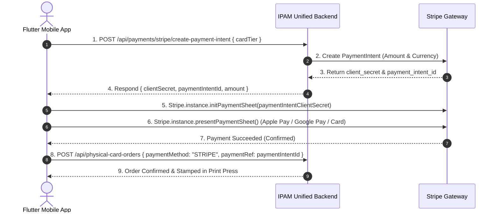

# 13. Payments (Stripe Gateway) API Integration

* **Swagger UI Documentation:** [https://ipam.billnbite.cloud/api-docs#/Payments](https://ipam.billnbite.cloud/api-docs#/Payments)
* **Tag:** `Payments`
* **Security Schemes:** `BearerAuth`

---

## 📌 Overview

The Payments module provides payment gateway integration using **Stripe**. It allows mobile users to securely purchase physical ID smart cards, subscribe to premium membership tiers, and contribute to endowment funds.

---

## 🔄 Mobile Payment Flow Architecture



---

## 🛣️ Endpoints Breakdown

### 1. Create Stripe PaymentIntent
* **Method & Path:** `POST /api/payments/stripe/create-payment-intent`
* **Auth Required:** `BearerAuth`
* **Description:** Initializes a Stripe payment session with server-validated pricing, preventing client-side amount tampering.

#### Request Body (`application/json`)
| Field | Type | Required | Description | Example |
|---|---|---|---|---|
| `cardTier` | `string` | **Yes** | `"STANDARD_PVC"`, `"GOLD_RFID_SMART"`, or `"EXECUTIVE_TITANIUM"` | `"GOLD_RFID_SMART"` |
| `recipientName` | `string` | No | Cardholder name | `"Alex Sesay"` |

```json
{
  "cardTier": "GOLD_RFID_SMART",
  "recipientName": "Alex Sesay"
}
```

#### Success Response (`200 OK`)
```json
{
  "data": {
    "clientSecret": "pi_3Nxyz123_secret_abc456",
    "paymentIntentId": "pi_3Nxyz123",
    "amount": 35.0,
    "currency": "usd"
  }
}
```

#### Error Responses
* `400 Bad Request`: Card tier disabled or Stripe gateway unconfigured.
* `401 Unauthorized`: Missing or invalid Bearer token.

---

## 📱 Flutter Implementation with `flutter_stripe`

### 1. Add Dependencies & Configure iOS / Android

In `pubspec.yaml`:
```yaml
dependencies:
  flutter_stripe: ^11.4.0
```

In your main entrypoint `lib/main.dart`:
```dart
import 'package:flutter/material.dart';
import 'package:flutter_stripe/flutter_stripe.dart';

void main() async {
  WidgetsFlutterBinding.ensureInitialized();

  // Set your public Stripe Publishable Key
  Stripe.publishableKey = 'pk_test_your_stripe_publishable_key';
  await Stripe.instance.applySettings();

  runApp(const MyApp());
}
```

### 2. Payment Service Repository (`lib/services/payment_service.dart`)

```dart
import 'package:dio/dio.dart';
import 'package:flutter_stripe/flutter_stripe.dart';
import '../core/api/api_client.dart';

class PaymentService {
  final ApiClient _client = ApiClient();

  /// Initiates PaymentIntent on backend and launches native Stripe Payment Sheet
  Future<String?> processStripeCardPayment({
    required String cardTier,
    required String recipientName,
  }) async {
    try {
      // Step 1: Request PaymentIntent clientSecret from backend
      final response = await _client.dio.post(
        '/api/payments/stripe/create-payment-intent',
        data: {
          'cardTier': cardTier,
          'recipientName': recipientName,
        },
      );

      final data = response.data['data'];
      final clientSecret = data['clientSecret'];
      final paymentIntentId = data['paymentIntentId'];

      // Step 2: Initialize native Stripe Payment Sheet
      await Stripe.instance.initPaymentSheet(
        paymentSheetParameters: SetupPaymentSheetParameters(
          paymentIntentClientSecret: clientSecret,
          merchantDisplayName: 'IPAM Alumni Association',
          style: ThemeMode.dark,
        ),
      );

      // Step 3: Present Payment Sheet to user
      await Stripe.instance.presentPaymentSheet();

      // Return paymentIntentId to link to the final order
      return paymentIntentId;
    } on StripeException catch (e) {
      if (e.error.code == FailureCode.Canceled) {
        // User cancelled payment sheet
        return null;
      }
      throw Exception(e.error.localizedMessage ?? 'Payment failed');
    } on DioException catch (e) {
      throw Exception(e.response?.data?['error'] ?? 'Payment initiation failed');
    }
  }
}
```

### 3. Complete Checkout Integration Flow

```dart
import 'package:flutter/material.dart';
import '../services/payment_service.dart';
import '../services/card_order_service.dart';

class CheckoutButton extends StatefulWidget {
  final String cardTier;
  final String recipientName;
  final String recipientPhone;
  final String deliveryAddress;

  const CheckoutButton({
    Key? key,
    required this.cardTier,
    required this.recipientName,
    required this.recipientPhone,
    required this.deliveryAddress,
  }) : super(key: key);

  @override
  State<CheckoutButton> createState() => _CheckoutButtonState();
}

class _CheckoutButtonState extends State<CheckoutButton> {
  final PaymentService _paymentService = PaymentService();
  final CardOrderService _cardService = CardOrderService();
  bool _isProcessing = false;

  Future<void> _handleStripeCheckout() async {
    setState(() => _isProcessing = true);
    try {
      // 1. Process Stripe native payment sheet
      final paymentRef = await _paymentService.processStripeCardPayment(
        cardTier: widget.cardTier,
        recipientName: widget.recipientName,
      );

      if (paymentRef == null) {
        // User dismissed sheet
        setState(() => _isProcessing = false);
        return;
      }

      // 2. Submit card order with verified paymentRef
      final order = await _cardService.createOrder(
        cardTier: widget.cardTier,
        recipientName: widget.recipientName,
        recipientPhone: widget.recipientPhone,
        deliveryAddress: widget.deliveryAddress,
        paymentMethod: 'STRIPE',
        paymentRef: paymentRef,
      );

      ScaffoldMessenger.of(context).showSnackBar(
        SnackBar(content: Text('Order ${order.orderNumber} placed successfully!')),
      );
    } catch (e) {
      ScaffoldMessenger.of(context).showSnackBar(
        SnackBar(content: Text(e.toString()), backgroundColor: Colors.red),
      );
    } finally {
      setState(() => _isProcessing = false);
    }
  }

  @override
  Widget build(BuildContext context) {
    return ElevatedButton.icon(
      icon: const Icon(Icons.payment),
      label: _isProcessing
          ? const SizedBox(width: 20, height: 20, child: CircularProgressIndicator(color: Colors.white, strokeWidth: 2))
          : const Text("Pay with Stripe & Order"),
      onPressed: _isProcessing ? null : _handleStripeCheckout,
    );
  }
}
```
