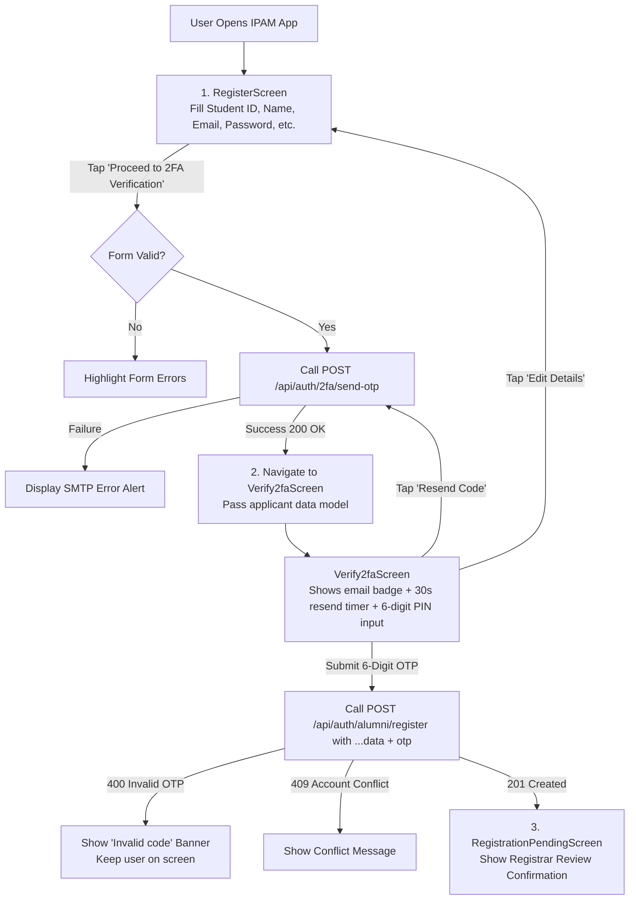

# 🔐 IPAM Mobile App — Dynamic 2FA Email Authentication Refactor Guide

* **Target Application:** `IPAM-mobile` (Flutter Android & iOS)
* **API Version:** Compatible with IPAM Unified Backend `v1.0` / Next.js 16
* **Backend Base URL:** `https://ipam.billnbite.cloud` (or local Docker `http://10.0.2.2:3000` on Android Emulator / `http://localhost:3000` on iOS Simulator)
* **Auth Standard:** Single-use 6-digit Dynamic Cryptographic OTP via Gmail SMTP (`growpos.official@gmail.com`)

---

## 📌 1. Overview & Architecture Transition

### The Problem with the Previous Implementation
Previously, mobile onboarding and sandbox environments used a static fallback OTP (`123456`) displayed directly in a modal popup. This caused security issues, allowed bypass of email verification, and created disjointed UX with nested modals.

### The New Architecture
1. **Strictly Dynamic SMTP Delivery:** The backend dynamically generates a single-use 6-digit cryptographic number (`crypto.randomInt(100000, 999999)`), caches it in memory with a 15-minute expiration, and dispatches it immediately via **Gmail SMTP** directly to the applicant's real email address.
2. **Dedicated Screen Flow (No Popups):** The mobile application must transition the user from the registration form to a dedicated **`Verify2faScreen`**, mirroring the web platform's dedicated `/register/verify` architecture.
3. **Anti-Replay & Zero Leakage:** OTPs are invalidated immediately upon successful verification. API response payloads **never** expose `devOtp` or secret codes to the client.
4. **Resend Cooldown:** The client enforces a 30-second resend cooldown timer to prevent SMTP mailbox throttling.

---

## 📱 2. Mobile User Flow & Screen Navigation



---

## 📡 3. Backend API Specifications

### 1. Dispatch 2FA OTP Code
Call this when the user taps **"Proceed to 2FA Verification"** on the registration screen, or taps **"Resend Code"** on the 2FA screen.

* **Method & Path:** `POST /api/auth/2fa/send-otp`
* **Authentication:** None (Public)
* **Headers:** `Content-Type: application/json`

#### Request Payload
```json
{
  "email": "jane.doe@alumni.ipam.edu",
  "purpose": "REGISTRATION",
  "name": "Jane Doe"
}
```

| Field | Type | Required | Description |
|---|---|---|---|
| `email` | `string` | **Yes** | Destination email address. Validated with standard email regex. |
| `purpose` | `string` | No | `REGISTRATION` (default), `PASSWORD_RESET`, or `LOGIN_2FA` |
| `name` | `string` | No | Applicant name for personalized high-security email template |

#### Success Response (`200 OK`)
```json
{
  "data": {
    "sent": true,
    "message": "A 6-digit dynamic verification code has been dispatched via SMTP email to jane.doe@alumni.ipam.edu.",
    "expiresInMinutes": 15
  }
}
```

#### Error Response (`400 Bad Request` or `500 Internal Server Error`)
```json
{
  "error": "Failed to deliver verification email via SMTP. Please check your address."
}
```

---

### 2. Submit Final Registration with Dynamic OTP
Call this when the user enters the 6-digit verification code on the `Verify2faScreen`.

* **Method & Path:** `POST /api/auth/alumni/register`
* **Authentication:** None (Public)
* **Headers:** `Content-Type: application/json`

#### Request Payload
```json
{
  "email": "jane.doe@alumni.ipam.edu",
  "studentId": "IPAM-2022-8492",
  "password": "Password123!",
  "name": "Jane Doe",
  "classYear": 2022,
  "degree": "B.Sc. Applied Computing",
  "major": "Software Engineering",
  "currentRole": "Software Engineer",
  "company": "Apex Technologies",
  "location": "Freetown",
  "country": "Sierra Leone",
  "industry": "Technology",
  "bio": "Passionate about mobile apps and civic tech.",
  "isMentor": true,
  "otp": "813707"
}
```

| Field | Type | Required | Description |
|---|---|---|---|
| `email` | `string` | **Yes** | University or personal email |
| `studentId` | `string` | **Yes** | University Reg/Student ID (e.g. `IPAM-2022-8492`) |
| `password` | `string` | **Yes** | Minimum 8 characters |
| `name` | `string` | **Yes** | Full candidate name |
| `classYear` | `integer` | **Yes** | Graduation year (1950 - 2040) |
| `degree` | `string` | **Yes** | Degree program earned |
| `major` | `string` | **Yes** | Major / Faculty |
| `otp` | `string` | **Yes** | **Exact 6-digit dynamic code received in user's email** |
| `currentRole` | `string` | No | Current job title |
| `company` | `string` | No | Current employer |
| `location` | `string` | No | City of residence |
| `country` | `string` | No | Country of residence |
| `industry` | `string` | No | Industry sector |
| `bio` | `string` | No | Short professional biography |
| `isMentor` | `boolean` | No | Willing to mentor students/graduates (default: `false`) |

#### Success Response (`201 Created`)
```json
{
  "data": {
    "message": "Registration submitted successfully. Your account is pending administrator approval.",
    "status": "PENDING"
  }
}
```

#### Error Responses
* `400 Bad Request` (Invalid or Expired OTP):
  ```json
  {
    "error": "Invalid verification code. Please check your email inbox and enter the dynamic 6-digit code received."
  }
  ```
* `409 Conflict` (Already registered):
  ```json
  {
    "error": "An approved account with this email or student ID already exists. Please sign in."
  }
  ```

---

### 3. Password Reset Flow (Using Dynamic SMTP OTP)

#### Step 1: Request Password Reset Code
* **Path:** `POST /api/auth/forgot-password`
* **Body:** `{ "email": "user@ipam.edu" }`
* **Response (`200 OK`):**
  ```json
  {
    "data": {
      "message": "A 6-digit dynamic password reset verification code has been dispatched to your email.",
      "email": "user@ipam.edu"
    }
  }
  ```

#### Step 2: Confirm Reset with OTP
* **Path:** `POST /api/auth/reset-password`
* **Body:**
  ```json
  {
    "email": "user@ipam.edu",
    "otp": "492817",
    "newPassword": "NewSecurePassword123!"
  }
  ```
* **Response (`200 OK`):**
  ```json
  {
    "data": {
      "message": "Password reset successfully. You can now log in with your new password."
    }
  }
  ```

---

## 💻 4. Flutter Implementation Code

### 1. Data Models (`lib/models/auth_dto.dart`)

```dart
class RegistrationDraft {
  final String email;
  final String studentId;
  final String password;
  final String name;
  final int classYear;
  final String degree;
  final String major;
  final String? currentRole;
  final String? company;
  final String? location;
  final String? country;
  final String? industry;
  final String? bio;
  final bool isMentor;

  RegistrationDraft({
    required this.email,
    required this.studentId,
    required this.password,
    required this.name,
    required this.classYear,
    required this.degree,
    required this.major,
    this.currentRole,
    this.company,
    this.location,
    this.country,
    this.industry,
    this.bio,
    this.isMentor = false,
  });

  Map<String, dynamic> toJson({required String otp}) {
    return {
      'email': email.trim().toLowerCase(),
      'studentId': studentId.trim(),
      'password': password,
      'name': name.trim(),
      'classYear': classYear,
      'degree': degree.trim(),
      'major': major.trim(),
      'currentRole': currentRole?.trim() ?? '',
      'company': company?.trim() ?? '',
      'location': location?.trim() ?? '',
      'country': country?.trim() ?? '',
      'industry': industry?.trim() ?? 'General',
      'bio': bio?.trim() ?? '',
      'isMentor': isMentor,
      'otp': otp.trim(),
    };
  }
}
```

---

### 2. Auth Service (`lib/services/auth_service.dart`)

```dart
import 'package:dio/dio.dart';
import '../models/auth_dto.dart';

class AuthService {
  final Dio _dio;

  AuthService({Dio? dio})
      : _dio = dio ??
            Dio(
              BaseOptions(
                baseUrl: 'https://ipam.billnbite.cloud',
                connectTimeout: const Duration(seconds: 15),
                receiveTimeout: const Duration(seconds: 15),
                headers: {'Content-Type': 'application/json'},
              ),
            );

  /// 1. Sends dynamic single-use 6-digit OTP code to the user's email via SMTP
  Future<void> sendRegistrationOtp({
    required String email,
    required String name,
  }) async {
    try {
      final response = await _dio.post(
        '/api/auth/2fa/send-otp',
        data: {
          'email': email.trim(),
          'purpose': 'REGISTRATION',
          'name': name.trim(),
        },
      );

      if (response.statusCode != 200) {
        throw Exception(response.data['error'] ?? 'Failed to send verification email');
      }
    } on DioException catch (e) {
      final errorMsg = e.response?.data?['error'] ?? 'Network error delivering verification code.';
      throw Exception(errorMsg);
    }
  }

  /// 2. Submits candidate registration profile with the user-entered 6-digit OTP
  Future<void> submitRegistration({
    required RegistrationDraft draft,
    required String otp,
  }) async {
    try {
      final response = await _dio.post(
        '/api/auth/alumni/register',
        data: draft.toJson(otp: otp),
      );

      if (response.statusCode != 201) {
        throw Exception(response.data['error'] ?? 'Registration failed');
      }
    } on DioException catch (e) {
      final errorMsg = e.response?.data?['error'] ??
          e.response?.data?['issues']?['formErrors']?[0] ??
          'Verification failed. Please re-check your code.';
      throw Exception(errorMsg);
    }
  }

  /// 3. Initiates password reset OTP
  Future<void> requestPasswordResetOtp(String email) async {
    try {
      await _dio.post('/api/auth/forgot-password', data: {'email': email.trim()});
    } on DioException catch (e) {
      throw Exception(e.response?.data?['error'] ?? 'Failed to request reset code');
    }
  }

  /// 4. Confirms password reset with OTP
  Future<void> resetPasswordWithOtp({
    required String email,
    required String otp,
    required String newPassword,
  }) async {
    try {
      await _dio.post('/api/auth/reset-password', data: {
        'email': email.trim(),
        'otp': otp.trim(),
        'newPassword': newPassword,
      });
    } on DioException catch (e) {
      throw Exception(e.response?.data?['error'] ?? 'Password reset failed');
    }
  }
}
```

---

### 3. Dedicated 2FA Verification Screen (`lib/screens/verify_2fa_screen.dart`)

```dart
import 'dart:async';
import 'package:flutter/material.dart';
import 'package:flutter/services.dart';
import '../models/auth_dto.dart';
import '../services/auth_service.dart';
import 'registration_pending_screen.dart';

class Verify2faScreen extends StatefulWidget {
  final RegistrationDraft draft;

  const Verify2faScreen({super.key, required this.draft});

  @override
  State<Verify2faScreen> createState() => _Verify2faScreenState();
}

class _Verify2faScreenState extends State<Verify2faScreen> {
  final _authService = AuthService();
  final _otpController = TextEditingController();

  bool _isSubmitting = false;
  bool _isResending = false;
  String? _errorMessage;

  // 30-second cooldown timer for resending OTP
  int _resendCooldown = 30;
  Timer? _timer;

  @override
  void initState() {
    super.initState();
    _startCooldownTimer();
  }

  void _startCooldownTimer() {
    setState(() => _resendCooldown = 30);
    _timer?.cancel();
    _timer = Timer.periodic(const Duration(seconds: 1), (timer) {
      if (_resendCooldown <= 1) {
        timer.cancel();
        setState(() => _resendCooldown = 0);
      } else {
        setState(() => _resendCooldown--);
      }
    });
  }

  @override
  void dispose() {
    _timer?.cancel();
    _otpController.dispose();
    super.dispose();
  }

  Future<void> _handleResendCode() async {
    if (_resendCooldown > 0 || _isResending) return;

    setState(() {
      _isResending = true;
      _errorMessage = null;
    });

    try {
      await _authService.sendRegistrationOtp(
        email: widget.draft.email,
        name: widget.draft.name,
      );
      _startCooldownTimer();
      if (mounted) {
        ScaffoldMessenger.of(context).showSnackBar(
          SnackBar(
            backgroundColor: const Color(0xFF065F46),
            content: Text(
              'A new 6-digit code has been dispatched to ${widget.draft.email}',
              style: const TextStyle(fontWeight: FontWeight.bold),
            ),
          ),
        );
      }
    } catch (err) {
      setState(() => _errorMessage = err.toString().replaceAll('Exception: ', ''));
    } finally {
      if (mounted) setState(() => _isResending = false);
    }
  }

  Future<void> _handleVerifyAndSubmit() async {
    final cleanOtp = _otpController.text.trim();
    if (cleanOtp.length != 6) {
      setState(() => _errorMessage = 'Please enter the complete 6-digit verification code.');
      return;
    }

    setState(() {
      _isSubmitting = true;
      _errorMessage = null;
    });

    try {
      await _authService.submitRegistration(
        draft: widget.draft,
        otp: cleanOtp,
      );

      if (mounted) {
        Navigator.of(context).pushAndRemoveUntil(
          MaterialPageRoute(
            builder: (_) => RegistrationPendingScreen(
              name: widget.draft.name,
              studentId: widget.draft.studentId,
            ),
          ),
          (route) => false,
        );
      }
    } catch (err) {
      setState(() => _errorMessage = err.toString().replaceAll('Exception: ', ''));
    } finally {
      if (mounted) setState(() => _isSubmitting = false);
    }
  }

  @override
  Widget build(BuildContext context) {
    const bgDark = Color(0xFF020617);
    const cardDark = Color(0xFF0F172A);
    const emeraldPrimary = Color(0xFF10B981);

    return Scaffold(
      backgroundColor: bgDark,
      appBar: AppBar(
        backgroundColor: bgDark,
        elevation: 0,
        leading: IconButton(
          icon: const Icon(Icons.arrow_back, color: Colors.white),
          onPressed: () => Navigator.of(context).pop(), // Returns to Registration form with data intact
        ),
        title: const Text(
          'Security Verification',
          style: TextStyle(color: Colors.white, fontSize: 16, fontWeight: FontWeight.bold),
        ),
      ),
      body: SafeArea(
        child: SingleChildScrollView(
          padding: const EdgeInsets.symmetric(horizontal: 24, vertical: 16),
          child: Column(
            crossAxisAlignment: CrossAxisAlignment.center,
            children: [
              const SizedBox(height: 12),
              // Security Shield Icon
              Container(
                height: 72,
                width: 72,
                decoration: BoxDecoration(
                  color: const Color(0xFF064E3B).withOpacity(0.4),
                  shape: BoxShape.circle,
                  border: Border.all(color: emeraldPrimary.withOpacity(0.4), width: 2),
                ),
                child: const Icon(Icons.shield_outlined, color: emeraldPrimary, size: 36),
              ),
              const SizedBox(height: 20),

              // Title
              const Text(
                'Two-Factor Authentication',
                style: TextStyle(color: Colors.white, fontSize: 22, fontWeight: FontWeight.w900),
              ),
              const SizedBox(height: 6),
              Text(
                'Verify your university email address to submit your profile',
                textAlign: TextAlign.center,
                style: TextStyle(color: Colors.slate[400], fontSize: 13),
              ),
              const SizedBox(height: 24),

              // SMTP Email Info Card
              Container(
                padding: const EdgeInsets.all(16),
                decoration: BoxDecoration(
                  color: cardDark,
                  borderRadius: BorderRadius.circular(16),
                  border: Border.all(color: const Color(0xFF1E293B)),
                ),
                child: Column(
                  children: [
                    Row(
                      mainAxisAlignment: MainAxisAlignment.spaceBetween,
                      children: [
                        const Row(
                          children: [
                            Icon(Icons.mark_email_read_outlined, color: emeraldPrimary, size: 16),
                            SizedBox(width: 6),
                            Text('SMTP Verification',
                                style: TextStyle(
                                    color: emeraldPrimary, fontSize: 12, fontWeight: FontWeight.bold)),
                          ],
                        ),
                        Container(
                          padding: const EdgeInsets.symmetric(horizontal: 8, vertical: 2),
                          decoration: BoxDecoration(
                            color: const Color(0xFF065F46),
                            borderRadius: BorderRadius.circular(12),
                          ),
                          child: const Text('Dispatched',
                              style: TextStyle(color: Colors.white, fontSize: 10, fontWeight: FontWeight.w700)),
                        ),
                      ],
                    ),
                    const SizedBox(height: 12),
                    Text(
                      'A single-use 6-digit dynamic code was dispatched to:',
                      style: TextStyle(color: Colors.slate[300], fontSize: 12),
                    ),
                    const SizedBox(height: 6),
                    Container(
                      width: double.infinity,
                      padding: const EdgeInsets.symmetric(vertical: 8, horizontal: 12),
                      decoration: BoxDecoration(
                        color: const Color(0xFF020617),
                        borderRadius: BorderRadius.circular(8),
                        border: Border.all(color: const Color(0xFF334155)),
                      ),
                      child: Text(
                        widget.draft.email,
                        textAlign: TextAlign.center,
                        style: const TextStyle(
                          color: Colors.white,
                          fontFamily: 'monospace',
                          fontWeight: FontWeight.w800,
                          fontSize: 14,
                        ),
                      ),
                    ),
                    const SizedBox(height: 8),
                    Text(
                      'Please check your inbox & spam folder. Code expires in 15 minutes.',
                      textAlign: TextAlign.center,
                      style: TextStyle(color: Colors.slate[500], fontSize: 11),
                    ),
                  ],
                ),
              ),
              const SizedBox(height: 28),

              // 6-Digit OTP Input Field
              const Text(
                'Enter 6-Digit Verification Code',
                style: TextStyle(color: Colors.white, fontSize: 13, fontWeight: FontWeight.bold),
              ),
              const SizedBox(height: 12),

              TextField(
                controller: _otpController,
                autofocus: true,
                keyboardType: TextInputType.number,
                textAlign: TextAlign.center,
                maxLength: 6,
                inputFormatters: [FilteringTextInputFormatter.digitsOnly],
                style: const TextStyle(
                  color: Colors.white,
                  fontFamily: 'monospace',
                  fontSize: 28,
                  fontWeight: FontWeight.w900,
                  letterSpacing: 12,
                ),
                decoration: InputDecoration(
                  counterText: '',
                  hintText: '••••••',
                  hintStyle: TextStyle(color: Colors.slate[700], letterSpacing: 12),
                  filled: true,
                  fillColor: cardDark,
                  contentPadding: const EdgeInsets.symmetric(vertical: 16),
                  border: OutlineInputBorder(
                    borderRadius: BorderRadius.circular(16),
                    borderSide: const BorderSide(color: Color(0xFF334155)),
                  ),
                  focusedBorder: OutlineInputBorder(
                    borderRadius: BorderRadius.circular(16),
                    borderSide: const BorderSide(color: emeraldPrimary, width: 2),
                  ),
                ),
              ),

              // Error display
              if (_errorMessage != null) ...[
                const SizedBox(height: 12),
                Container(
                  width: double.infinity,
                  padding: const EdgeInsets.all(12),
                  decoration: BoxDecoration(
                    color: const Color(0xFF4C0519).withOpacity(0.5),
                    borderRadius: BorderRadius.circular(12),
                    border: Border.all(color: const Color(0xFFF43F5E).withOpacity(0.4)),
                  ),
                  child: Text(
                    _errorMessage!,
                    textAlign: TextAlign.center,
                    style: const TextStyle(color: Color(0xFFFDA4AF), fontSize: 12, fontWeight: FontWeight.w600),
                  ),
                ),
              ],

              const SizedBox(height: 24),

              // Action Buttons
              SizedBox(
                width: double.infinity,
                height: 52,
                child: ElevatedButton(
                  onPressed: _isSubmitting ? null : _handleVerifyAndSubmit,
                  style: ElevatedButton.styleFrom(
                    backgroundColor: emeraldPrimary,
                    foregroundColor: const Color(0xFF020617),
                    shape: RoundedRectangleBorder(borderRadius: BorderRadius.circular(14)),
                    elevation: 0,
                  ),
                  child: _isSubmitting
                      ? const SizedBox(
                          height: 20,
                          width: 20,
                          child: CircularProgressIndicator(color: Colors.black, strokeWidth: 2),
                        )
                      : const Row(
                          mainAxisAlignment: MainAxisAlignment.center,
                          children: [
                            Icon(Icons.check_circle_outline, size: 20),
                            SizedBox(width: 8),
                            Text('Verify & Submit Application',
                                style: TextStyle(fontSize: 15, fontWeight: FontWeight.w900)),
                          ],
                        ),
                ),
              ),

              const SizedBox(height: 16),

              // Resend Code Button with countdown
              Row(
                mainAxisAlignment: MainAxisAlignment.center,
                children: [
                  Text("Didn't receive the email?", style: TextStyle(color: Colors.slate[400], fontSize: 12)),
                  const SizedBox(width: 6),
                  GestureDetector(
                    onTap: (_resendCooldown > 0 || _isResending) ? null : _handleResendCode,
                    child: Text(
                      _resendCooldown > 0
                          ? 'Resend in ${_resendCooldown}s'
                          : (_isResending ? 'Sending...' : 'Resend Code'),
                      style: TextStyle(
                        color: _resendCooldown > 0 ? Colors.slate[600] : emeraldPrimary,
                        fontSize: 12,
                        fontWeight: FontWeight.bold,
                      ),
                    ),
                  ),
                ],
              ),
            ],
          ),
        ),
      ),
    );
  }
}
```

---

## 🧪 5. Testing & Verification Checklist

| Scenario | Expected Result |
|---|---|
| **Valid Code Submission** | Dispatches email, user inputs code, backend returns `201 Created` with `status: PENDING`. |
| **Wrong Code (`000000`)** | Backend rejects with `400 Bad Request` ("Invalid verification code"). |
| **Replay Attack** | Submitting the same OTP code twice fails with `400 Bad Request`. |
| **Static Code (`123456`)** | Strictly rejected unless backend runs with `ALLOW_TEST_OTP=true`. |
| **Resend Cooldown** | Button disables for 30s with live countdown timer. |
| **Back Navigation** | User can tap Back arrow, update form fields (e.g. correct typo), and proceed again. |

---

## 🛠️ Summary of Backend Routes for Mobile Team

| Purpose | Method | Endpoint |
|---|---|---|
| **Send 2FA Code** | `POST` | `/api/auth/2fa/send-otp` |
| **Register + Verify** | `POST` | `/api/auth/alumni/register` |
| **Forgot Password Code** | `POST` | `/api/auth/forgot-password` |
| **Reset Password with Code**| `POST` | `/api/auth/reset-password` |
| **Login with Device Token**| `POST` | `/api/auth/alumni/login` |
