# IPAM Alumni Flutter Mobile App — Complete Feature Context & Architecture Blueprint

This document specifies the complete feature context, screen-by-screen UX specifications, business rules, API mappings, and technical architecture required to build the official **IPAM Alumni Flutter Mobile App** matching 100% of the active Web Application features.

---

## 🎨 1. Design System, Typography & Branding

### Brand Color Tokens
* **Primary / Accent Emerald:** `#10B981` (Emerald 500), `#059669` (Emerald 600)
* **Background Deep Slate:** `#020617` (Slate 950 - Main Screen Background)
* **Surface / Card Slate:** `#0F172A` (Slate 900), `#1E293B` (Slate 800)
* **Borders / Separators:** `#334155` (Slate 700 / 50% opacity)
* **Gold Patron Accent:** `#F59E0B` (Amber 500), `#D97706` (Amber 600)
* **Verified Shield Blue:** `#3B82F6` (Blue 500)
* **Text High Contrast:** `#F8FAFC` (White/Slate 50), `#CBD5E1` (Muted Slate 300), `#94A3B8` (Subtle Slate 400)
* **Status Badges:**
  * Active / Approved: `#10B981` (Green)
  * Pending Review: `#F59E0B` (Amber)
  * Rejected / Cancelled: `#F43F5E` (Rose)

### Typography & Iconography
* **Font Family:** `Inter` or `Plus Jakarta Sans` via Google Fonts.
* **Icons:** `Lucide Icons` (or `lucide_icons` Flutter package) matching the web portal.

---

## 📱 2. Information Architecture & Navigation Structure

```mermaid
graph TD
    Splash[Splash & Session Check] -->|Token Valid| MainScaffold[Main App Scaffold / Bottom Nav]
    Splash -->|No Token| AuthFlow[Authentication Flow]
    
    AuthFlow --> LoginScreen[Sign In]
    AuthFlow --> RegisterScreen[Alumni Registration + 2FA OTP]
    AuthFlow --> PendingScreen[Registration Pending Review Screen]

    MainScaffold --> Tab1[Tab 1: Home Dashboard]
    MainScaffold --> Tab2[Tab 2: Virtual ID Pass]
    MainScaffold --> Tab3[Tab 3: Alumni Directory]
    MainScaffold --> Tab4[Tab 4: Careers & Jobs]
    MainScaffold --> Tab5[Tab 5: More Services]

    Tab1 --> HeroSlider[Spotlight Carousel]
    Tab1 --> QuickShortcuts[Quick Action Tiles]
    Tab1 --> NotificationCenter[Broadcast Announcements]
    Tab1 --> SponsorBanners[Commercial Banners]

    Tab2 --> FlipCard[3D Flip Digital Pass Card]
    Tab2 --> QrRenderer[Full-screen QrImageView]
    Tab2 --> PhysicalCardFlow[Order PVC / RFID Smart Card]
    Tab2 --> VerifierScanner[Camera Scanner Check-in]

    Tab3 --> DirectoryList[Search & Filter by Year/Faculty/Mentor]
    Tab3 --> PublicProfile[Alumni Member Profile]
    Tab3 --> ConnectionsBook[My Bookmarks & Network]

    Tab4 --> JobList[Openings with Workplace Type/Category]
    Tab4 --> JobDetail[Specifications & Match Score]
    Tab4 --> ApplyModal[Submit Application with CV PDF]
    Tab4 --> ApplicationTracker[Track Applications & Recruiter Remarks]
    Tab4 --> SavedJobs[Saved Jobs Bookmarks]

    Tab5 --> EventsModule[Events, RSVP Tickets & Cancellations]
    Tab5 --> BusinessModule[Alumni Marketplace & Submit Business]
    Tab5 --> GivingModule[Endowments & Stripe Donations]
    Tab5 --> SubscriptionsModule[Membership Tier Upgrade & Auto-Renew]
    Tab5 --> LeadershipModule[Executive Council Directory]
    Tab5 --> ProfileModule[Edit Bio, Skills, Photo & Password]
```



---

## 🖥️ 3. Screen-by-Screen Feature Specifications

### Screen 1: Splash & Authentication (`/login`, `/register`)
* **Features:**
  * Splash Screen checks `flutter_secure_storage` for `ipam_alumni_jwt_token`.
  * If valid, calls `GET /api/auth/alumni/me` to refresh user state and navigates to `MainScaffold`.
  * **Login Screen:** Email + Password with "Remember Me" toggle. Error handling for bad credentials or unapproved account status (`PENDING` / `REJECTED`).
  * **Registration Flow:** Multi-step or accordion form capturing full name, university student registration ID (`IPAM-YYYY-XXXX`), graduation year, degree, faculty/major, current employer, job title, and mandatory 2FA OTP (`123456` in testing sandbox).
  * **Pending Account State:** If an account is created, displays a congratulatory modal indicating registrar verification is in progress.
* **APIs:**
  * `POST /api/auth/alumni/login`
  * `POST /api/auth/alumni/register`
  * `GET /api/auth/alumni/me`

---

### Screen 2: Home Dashboard (`/`, `/dashboard`)
* **Web Parity:** Matches `components/public/HomeHeroSection.tsx` & `app/(public)/dashboard/page.tsx`.
* **Features:**
  * **Header Utility Bar:** University crest, "Official IPAM Alumni Portal", notification bell with unread badge count, and user avatar.
  * **Identity Hero Banner:** Welcome message, graduation class badge, verified alumni checkmark, active tier chip (`STANDARD`, `GOLD_PATRON`, etc.), and student ID.
  * **Hero Announcement Slider:** Auto-scrolling carousel with headlines, imagery, and deep-link call-to-actions (`GET /api/hero-slides`).
  * **Quick Action Grid:**
    * "Digital Pass" (Quick opens Pass tab)
    * "Alumni Directory" (Quick opens Directory tab)
    * "Events & Galas" (Navigates to Events list)
    * "Job Openings" (Navigates to Careers)
    * "Giving & Endowment" (Navigates to Donations)
  * **Dynamic Commercial & Partner Banners:** Display sponsor banners (`GET /api/banners`) with automatic viewport impression logging (`POST /api/banners/impressions`) and click logging (`POST /api/banners/{id}/click`).
  * **Recent Broadcast Alerts:** Highlights newest university broadcast notices.
* **APIs:**
  * `GET /api/hero-slides`
  * `GET /api/banners`
  * `POST /api/banners/impressions`
  * `POST /api/banners/{id}/click`
  * `GET /api/alumni/notifications`

---

### Screen 3: Digital Virtual ID Pass & QR Scanner (`/pass`)
* **Web Parity:** Matches `components/public/VirtualPassView.tsx` & `VirtualIdModal.tsx`.
* **Features:**
  * **3D Flip Card Component:**
    * **Front Face:** High-security alumni ID card layout with university seal, hologram emblem, high-res avatar, member name, student registration number, degree program, graduation year, and colored tier chip (`Gold`, `Platinum`).
    * **Back Face:** High-density 2D QR code rendered from `qrPayload` JSON, NFC contactless verification indicator, security hash, and terms.
  * **Pass Action Bar:**
    * **Share Credential:** Uses native `share_plus` to send verified credential URL (`https://ipam.billnbite.cloud/pass?card=...`).
    * **Save QR to Gallery:** Saves high-resolution PNG image of the QR pass.
    * **Order Physical ID Card:** Opens physical card ordering sheet.
  * **Built-in QR Camera Scanner:**
    * Uses `mobile_scanner` to scan passes at reunions, webinars, or campus gates.
    * Calls `GET /api/alumni/pass/verify/{id}` to validate authenticity in real time.
* **APIs:**
  * `GET /api/alumni/pass`
  * `GET /api/alumni/pass/verify/{id}`

---

### Screen 4: Events, RSVP Bookings & Cancellations (`/events`)
* **Web Parity:** Matches `components/public/EventsView.tsx` & `EventDetailView.tsx`.
* **Features:**
  * **Event Directory:** List view with category filter pills (`All`, `GALA`, `WEBINAR`, `NETWORKING`, `CAREER_WORKSHOP`).
  * **Event Card:** High-resolution banner image, formatted date/time, physical campus venue or virtual meeting link badge, ticket price (or `FREE` chip), seat availability counter, and "RSVP" button.
  * **Event Detail Screen:** Rich description, schedule, capacity gauge (`X seats remaining of Y total`), attendee roster preview, and RSVP button.
  * **RSVP Booking Modal:** Collects ticket quantity, attendee details, and optional dietary/seating preferences. Generates `BK-EVT-...` booking reference.
  * **"My Tickets" Drawer/Screen:** Lists all confirmed tickets.
  * **Ticket Cancellation:** Allows canceling an RSVP for upcoming events to automatically release capacity.
  * **Propose Event:** Floating action button allowing alumni to submit event proposals (`POST /api/event-proposals`).
* **APIs:**
  * `GET /api/events`
  * `GET /api/events/{id}`
  * `POST /api/events/{id}/register`
  * `GET /api/events/my-registrations`
  * `GET /api/events/my-registrations/{bookingRef}`
  * `DELETE /api/events/my-registrations/{bookingRef}`
  * `POST /api/event-proposals`

---

### Screen 5: Careers, Jobs & Talent Hub (`/jobs`)
* **Web Parity:** Matches `components/public/JobsView.tsx`, `JobDetailView.tsx`, & `EmployerHireManagementView.tsx`.
* **Features:**
  * **Job Directory:** Search bar (`q`) with filter bottom-sheet for `category` (Engineering, Finance, Data/AI, Operations, Legal), `type` (Full Time, Contract, Remote), and `workplaceType` (On-site, Hybrid, Remote).
  * **Job Opening Card:** Employer logo, job title, company name, location, salary range pill, experience level, and one-tap bookmark toggle.
  * **Job Detail Screen:** Detailed role responsibilities, candidate requirements, company overview, and application button.
  * **Apply Modal:** One-tap application with candidate credentials, cover note, and PDF resume upload via `POST /api/upload`. Computes dynamic resume match score.
  * **"My Applications" Tab:** Tracks candidate status (`APPLIED`, `UNDER_REVIEW`, `INTERVIEW_SCHEDULED`, `OFFER_EXTENDED`, `REJECTED`), interview dates, and recruiter remarks.
  * **"Saved Jobs" Tab:** Fast access to bookmarked openings (`GET /api/jobs/saved`).
* **APIs:**
  * `GET /api/jobs`
  * `GET /api/jobs/{id}`
  * `POST /api/jobs/{id}/apply`
  * `GET /api/jobs/{id}/apply`
  * `POST /api/jobs/{id}/save`
  * `GET /api/jobs/saved`
  * `GET /api/jobs/my-applications`
  * `POST /api/upload` (for CV PDF files)

---

### Screen 6: Alumni Directory & Peer Networking (`/directory`)
* **Web Parity:** Matches `components/public/DirectoryView.tsx`.
* **Features:**
  * **Directory Search:** Real-time search by graduate name, company, job title, or skill tags.
  * **Filter Sheet:** Filter by graduation class year (e.g. `2015`), industry sector, and "Available for Mentorship" toggle (`isMentor=true`).
  * **Alumni Profile Card:** Member avatar with verified badge, degree, major, current role at company, city/country, mentor status badge, and "Connect" button.
  * **Member Detail Screen:** Full bio, employment history, education, verified LinkedIn link, and skill tag cloud.
  * **"My Network" Tab:** Displays bookmarked/connected alumni members (`GET /api/alumni/bookmarks`).
  * **Connect / Disconnect Actions:** Instant optimistic state toggle for connections.
* **APIs:**
  * `GET /api/alumni`
  * `GET /api/alumni/{id}`
  * `POST /api/alumni/{id}/connect`
  * `DELETE /api/alumni/{id}/connect`
  * `GET /api/alumni/bookmarks`

---

### Screen 7: Alumni Businesses & Marketplace (`/businesses`)
* **Web Parity:** Matches `components/public/BusinessesView.tsx`, `BusinessDetailView.tsx`, & `SubmitBusinessModal.tsx`.
* **Features:**
  * **Marketplace Directory:** Browse verified alumni-owned enterprises, startups, and consulting firms.
  * **Filter & Search:** Filter by category (`Technology`, `Energy`, `Consulting`, `Hospitality`), search query, or "Featured Enterprises" toggle.
  * **Business Detail Screen:** Company logo, cover banner, founder name with graduation year, tagline, description, services list, website link, verified email, and phone contact buttons.
  * **"My Businesses" Tab:** Lists businesses submitted by the authenticated alumni (`?mine=true`).
  * **Submit Business Modal:** Form to register a new commercial listing (requires logo image upload, founder graduation year, services array, contact info, and website).
  * **Edit / Delete Listing:** Allows owners to update services or delete listings.
* **APIs:**
  * `GET /api/businesses`
  * `POST /api/businesses`
  * `GET /api/businesses/{id}`
  * `PATCH /api/businesses/{id}`
  * `DELETE /api/businesses/{id}`
  * `POST /api/upload` (for business logo and banner)

---

### Screen 8: Physical Smart ID Card Bureau (`/pass` -> Order Form)
* **Web Parity:** Matches `components/public/PhysicalCardOrderForm.tsx` & `StripeCardPaymentSection.tsx`.
* **Features:**
  * **Tier & Material Selection:** Live cards comparing:
    * `STANDARD_PVC` ($15) — High-gloss university PVC with barcode.
    * `GOLD_RFID_SMART` ($30) — 13.56 MHz RFID contactless chip + NFC.
    * `EXECUTIVE_TITANIUM` ($60) — Laser-engraved metal core with VIP privileges.
  * **Pricing Engine:** Automatically calculates subtotal + courier shipping fees.
  * **Shipping Details Form:** Recipient full name, mobile phone number for courier dispatch, and delivery address in Sierra Leone or worldwide.
  * **Payment Channel Selection:**
    * **Stripe Native Card Checkout:** Uses `flutter_stripe` Payment Sheet.
    * **Cash on Delivery (`COD`):** Pay courier on physical delivery.
  * **Order Tracking Timeline:** Displays order stages (`RECEIVED` -> `IN_PRINT_PRESS` -> `QUALITY_CHECK` -> `DISPATCHED` -> `DELIVERED`), courier name, tracking number, and estimated arrival.
* **APIs:**
  * `GET /api/physical-card-orders/pricing`
  * `POST /api/payments/stripe/create-payment-intent`
  * `POST /api/physical-card-orders`
  * `GET /api/physical-card-orders`
  * `GET /api/physical-card-orders/{id}`

---

### Screen 9: University Endowments & Giving (`/giving`)
* **Web Parity:** Matches `components/public/GivingView.tsx`.
* **Features:**
  * **Active Campaign Cards:**
    * STEM Laboratory & Innovation Hub
    * Student Academic Excellence Endowment
    * Campus Solar Micro-grid & Digitalization Fund
  * **Preset & Custom Amount Chips:** Quick buttons for $25, $50, $100, $250, $500, or custom amounts.
  * **Giving Options:**
    * Frequency: One-time gift vs Monthly recurring donation.
    * Anonymity toggle: "List my gift as Anonymous on university feeds".
    * Dedication note: Personal tribute message honoring a professor, graduating class, or family member.
  * **Payment Integration:** Integrated Stripe payment flow.
  * **"My Giving History" Ledger:** View lifetime gifts, receipts, and contribution dates (`?mine=true`).
* **APIs:**
  * `GET /api/donations`
  * `POST /api/donations`
  * `GET /api/donations?mine=true`

---

### Screen 10: Membership & Subscription Tiers (`/subscription`)
* **Web Parity:** Matches `components/public/SubscriptionManagementView.tsx` & `SubscriptionManagementModal.tsx`.
* **Features:**
  * **Active Status Card:** Current membership tier (`STANDARD`, `SILVER_LIFETIME`, `GOLD_PATRON`), validity expiry date, and status chip.
  * **Tier Comparison Grid:** Comprehensive matrix highlighting perks: digital badge, voting privileges, physical RFID smart cards included, priority gala seats.
  * **Billing Cycle Selector:** Annual vs Lifetime subscription options.
  * **Auto-Renew Toggle Switch:** Allows enabling/disabling automated card renewals with immediate server persistence.
* **APIs:**
  * `GET /api/subscription`
  * `POST /api/subscription`
  * `PATCH /api/subscription`

---

### Screen 11: University Executive Leadership (`/about` -> Leadership)
* **Web Parity:** Matches `components/public/HomeLeadershipSection.tsx` & `LeadershipModal.tsx`.
* **Features:**
  * **Council Directory:** Visual roster of President, Vice President, Secretary General, Treasurer, and Committee Directors.
  * **Member Bio Card:** Official title, graduation class year, academic degrees, comprehensive biographical sketch, and direct LinkedIn profile connection.
* **APIs:**
  * `GET /api/leadership`

---

### Screen 12: Profile Management & Settings (`/profile`)
* **Web Parity:** Matches `components/public/ProfileManagementView.tsx` & `ProfileManagementModal.tsx`.
* **Features:**
  * **Avatar Upload:** One-tap camera or gallery selection using `image_picker` and uploaded via `POST /api/upload`.
  * **Career & Contact Info:** Update current role, company name, industry sector, city/country of residence, and bio.
  * **Skill Tag Management:** Add, remove, and filter custom skill tags.
  * **Mentorship Availability Toggle:** Opt-in to appear in the directory as an alumni mentor.
  * **Security Settings:** In-app password change form (`currentPassword`, `newPassword`).
  * **Sign Out / Switch Account:** Clears stored JWT token and redirects to login.
* **APIs:**
  * `GET /api/profile`
  * `PATCH /api/profile`
  * `POST /api/upload`
  * `POST /api/auth/alumni/change-password`
  * `POST /api/auth/alumni/logout`

---

### Screen 13: Notifications & Administrative Broadcasts (`/profile?tab=notifications`)
* **Web Parity:** Matches `components/public/notifications/AlumniNotificationsView.tsx` & `HeaderNotificationBell.tsx`.
* **Features:**
  * **Firebase Cloud Messaging (FCM):** Background push notifications for broadcasts, degree approvals, ID card shipments, job updates, and event RSVPs using `serviceAccountKey.json`.
  * **Device Token Lifecycle:** Registers device token upon app start/login via `POST /api/notifications/register-token` and unregisters on sign-out via `POST /api/notifications/unregister-token`.
  * **Notification Bell:** In top app bar with unread count badge.
  * **Broadcast & Alert List:** Official university alerts, urgent campus notices, event invitations, and career opportunities.
  * **Category Badges:** Filter by `EVENT`, `CAREER`, `MEMBERSHIP`, `URGENT`, `VERIFICATION`, `ID_CARD`.
  * **Action Links:** Tapping a notification opens the relevant target screen (e.g. Event details, Job opening, Pass).
* **APIs:**
  * `GET /api/alumni/notifications`
  * `PATCH /api/alumni/notifications/{id}/read`
  * `POST /api/alumni/notifications/read-all`
  * `POST /api/notifications/register-token`
  * `POST /api/notifications/unregister-token`
  * `GET /api/notifications/devices`
  * `POST /api/notifications/test`

---

## 🛠️ 4. Recommended Flutter Packages & Architecture

### Dependency Configuration (`pubspec.yaml`)
```yaml
dependencies:
  flutter:
    sdk: flutter
  
  # Networking & Storage
  dio: ^5.7.0
  flutter_secure_storage: ^9.2.2
  shared_preferences: ^2.3.2

  # State Management & Architecture
  flutter_bloc: ^8.1.6  # Or flutter_riverpod / provider
  equatable: ^2.0.5

  # UI, Icons & Animations
  google_fonts: ^6.2.1
  lucide_icons: ^0.252.0
  cached_network_image: ^3.4.1
  shimmer: ^3.0.0
  flutter_animate: ^4.5.0

  # Hardware, Camera & QR
  qr_flutter: ^4.1.0        # QR Pass Generation
  mobile_scanner: ^6.0.2    # Camera QR Pass Verifier
  image_picker: ^1.1.2      # Camera & Gallery Uploads
  file_picker: ^8.1.4       # PDF Resume Selection

  # Payments & Sharing
  flutter_stripe: ^11.4.0   # Native Stripe PaymentSheet
  share_plus: ^10.1.2       # Native Share Dialog
  url_launcher: ^6.3.1      # Open external LinkedIn & websites
```

---

## 🔒 5. Authentication & Token Interceptor

All API calls after authentication must carry:
```http
Authorization: Bearer <jwt_token>
```
Store the token securely using `flutter_secure_storage`. If any request returns `401 Unauthorized`, intercept the error, clear the local token, and navigate the user back to the Login screen.
